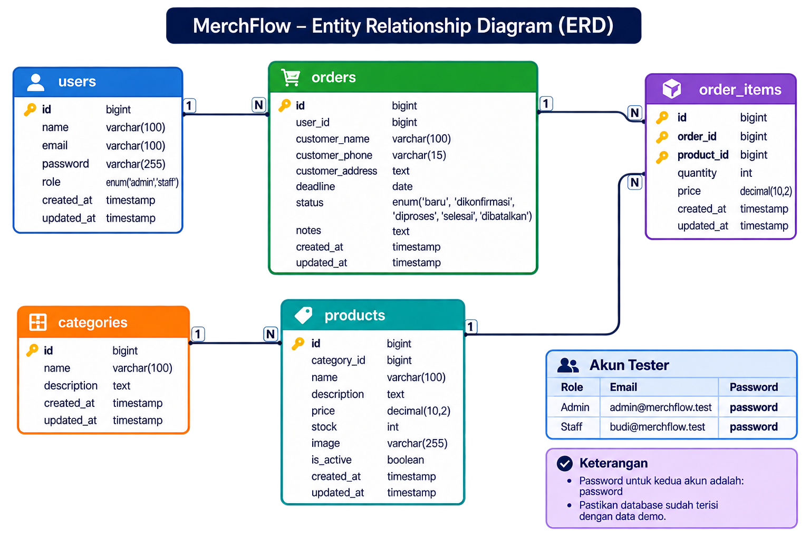

# MerchFlow — Merchandise Management System

Aplikasi web berbasis Laravel untuk membantu pengelolaan operasional bisnis merchandise, mulai dari manajemen kategori dan produk, pengelolaan pesanan pelanggan, pemantauan stok, hingga pengaturan hak akses pengguna.

MerchFlow dirancang untuk mempermudah proses pengelolaan pesanan merchandise agar data produk, stok, dan transaksi dapat dikelola melalui satu sistem yang terintegrasi.

---

## 1. Informasi Proyek

| Keterangan | Detail |
|---|---|
| Nama aplikasi | MerchFlow — Merchandise Management System |
| Framework | Laravel 12 |
| Bahasa pemrograman | PHP 8.2 atau lebih baru |
| Database | MySQL |
| Lingkungan pengembangan | Laragon |
| Antarmuka | Laravel Blade, HTML, CSS, JavaScript |
| Pola aplikasi | Model-View-Controller (MVC) |
| Deployment | Clever Cloud |
| Repository | [GitHub — uas-wad-merchflow](https://github.com/Dhafin0804/uas-wad-merchflow) |
| URL aplikasi | [https://uas-wad-merchflow.cleverapps.io](https://uas-wad-merchflow.cleverapps.io) |

## 2. Deskripsi Aplikasi

MerchFlow merupakan aplikasi manajemen merchandise yang dibuat untuk membantu pengelolaan data produk dan pesanan secara lebih terstruktur.

Dalam kegiatan operasional bisnis merchandise, pengelolaan produk, stok, dan pesanan perlu dilakukan secara konsisten agar tidak terjadi kesalahan pencatatan. Oleh karena itu, MerchFlow menyediakan sistem terpusat yang memungkinkan pengguna mengelola data tersebut melalui aplikasi web.

Aplikasi ini memiliki dua jenis pengguna, yaitu Admin dan Staff. Keduanya memiliki hak akses yang berbeda sesuai tanggung jawab masing-masing.

Melalui MerchFlow, pengguna dapat mengelola kategori produk, melakukan pencatatan produk, membuat dan memperbarui pesanan, memantau perubahan stok, serta melihat ringkasan aktivitas melalui dashboard.

## 3. Fitur Aplikasi

### 3.1 Autentikasi dan Hak Akses

Fitur autentikasi digunakan untuk mengatur akses pengguna ke dalam aplikasi.

Fitur yang tersedia:

- Login menggunakan email dan password.
- Logout dari aplikasi.
- Pengelolaan session pengguna.
- Penyimpanan password menggunakan mekanisme hashing Laravel.
- Pembatasan akses berdasarkan role Admin dan Staff.
- Halaman internal hanya dapat diakses oleh pengguna yang sudah login.

Sistem menggunakan middleware untuk memastikan pengguna hanya dapat mengakses halaman sesuai dengan hak aksesnya.

### 3.2 Dashboard

Dashboard merupakan halaman utama setelah pengguna berhasil login.

Informasi yang ditampilkan meliputi:

- Jumlah produk yang tersedia.
- Jumlah kategori produk.
- Jumlah pesanan.
- Ringkasan pesanan berdasarkan status.
- Daftar pesanan terbaru.

Dashboard membantu pengguna memperoleh gambaran singkat mengenai kondisi operasional MerchFlow tanpa harus membuka setiap halaman pengelolaan.

### 3.3 Manajemen Kategori

Fitur kategori digunakan untuk mengelompokkan produk merchandise agar lebih mudah dikelola.

Fitur yang tersedia:

- Melihat daftar kategori.
- Menambahkan kategori baru.
- Mengubah informasi kategori.
- Menghapus kategori yang belum digunakan oleh produk.

Sistem mencegah penghapusan kategori apabila kategori tersebut masih memiliki produk yang terhubung.

### 3.4 Manajemen Produk

Fitur produk digunakan untuk mengelola informasi merchandise yang tersedia di dalam sistem.

Data produk meliputi:

- Nama produk.
- Kategori produk.
- Deskripsi produk.
- Harga produk.
- Jumlah stok.
- Gambar produk.
- Status produk.

Fitur yang tersedia:

- Melihat daftar produk.
- Menambahkan produk baru.
- Mengubah informasi produk.
- Menghapus produk apabila belum memiliki riwayat transaksi pesanan.
- Menghubungkan produk dengan kategori.
- Memantau jumlah stok produk.

Sistem menggunakan validasi pada proses penambahan dan perubahan data agar informasi produk yang disimpan sesuai dengan ketentuan aplikasi.

### 3.5 Manajemen Pesanan

Fitur pesanan digunakan untuk mencatat dan mengelola permintaan merchandise dari pelanggan.

Informasi pesanan meliputi:

- Nama pelanggan.
- Nomor telepon pelanggan.
- Alamat pelanggan.
- Produk yang dipesan.
- Jumlah pesanan.
- Harga produk saat pemesanan.
- Tenggat waktu pesanan.
- Status pesanan.
- Catatan tambahan.

Fitur yang tersedia:

- Melihat daftar pesanan.
- Membuat pesanan baru.
- Mengubah informasi pesanan.
- Menghapus pesanan sesuai hak akses.
- Melihat detail informasi pesanan.
- Memperbarui status pesanan.

Status pesanan yang digunakan:

- **Baru:** pesanan baru dicatat ke dalam sistem.
- **Dikonfirmasi:** pesanan telah dikonfirmasi.
- **Diproses:** pesanan sedang dikerjakan.
- **Selesai:** pesanan telah diselesaikan.
- **Dibatalkan:** pesanan dibatalkan.

### 3.6 Pengelolaan Stok Otomatis

MerchFlow menghubungkan proses pemesanan dengan jumlah stok produk.

Ketika pesanan dibuat, sistem akan mengurangi stok produk berdasarkan jumlah yang dipesan.

Aturan perubahan stok:

- Pesanan baru dibuat: stok produk berkurang.
- Pesanan aktif dibatalkan: stok produk dikembalikan.
- Pesanan yang dibatalkan diaktifkan kembali: stok produk dikurangi kembali apabila stok mencukupi.
- Pesanan aktif dihapus: stok produk dikembalikan.
- Pesanan yang sudah dibatalkan dihapus: stok tidak dikembalikan untuk kedua kalinya.

Sistem juga menolak proses pemesanan apabila jumlah yang diminta melebihi stok yang tersedia.

Untuk menjaga konsistensi data, proses perubahan pesanan dan stok menggunakan database transaction serta penguncian data produk ketika diperlukan.

### 3.7 Ringkasan dan Riwayat Pesanan

Aplikasi menyediakan informasi pesanan melalui dashboard dan halaman pengelolaan pesanan.

Pengguna dapat melihat:

- Jumlah keseluruhan pesanan.
- Jumlah pesanan berdasarkan status.
- Informasi pesanan terbaru.
- Detail pesanan yang telah dicatat.

Informasi tersebut membantu pengguna memantau perkembangan pesanan yang sedang dikelola.

## 4. Role Pengguna

MerchFlow memiliki dua role pengguna, yaitu Admin dan Staff.

| Role | Hak Akses |
|---|---|
| Admin | Melihat dashboard, mengelola produk, kategori, dan pesanan, termasuk menambahkan, mengubah, serta menghapus data. |
| Staff | Melihat dashboard, produk, kategori, dan pesanan; menambahkan serta mengubah data sesuai fitur yang tersedia, tanpa hak menghapus data. |

Pembatasan akses diterapkan melalui middleware role pada route aplikasi. Pemeriksaan hak akses dilakukan di sisi server sehingga pembatasan tidak hanya bergantung pada tampilan antarmuka.

## 5. Akun Tester

Berikut akun yang dapat digunakan untuk menguji aplikasi MerchFlow:

| Role | Email | Password |
|---|---|---|
| Admin | admin@merchflow.test | `password` |
| Staff | budi@merchflow.test | `password` |

**Catatan:**

- Kedua akun merupakan akun demonstrasi MerchFlow.
- Akun Admin dan Staff disediakan melalui `DatabaseSeeder`.
- Password disimpan menggunakan mekanisme hashing Laravel.
- Untuk instalasi database baru, jalankan `php artisan db:seed` setelah migration.
- Kredensial tersebut hanya untuk pengujian dan demonstrasi, bukan untuk lingkungan produksi.

## 6. Persyaratan Sistem

Sebelum menjalankan MerchFlow secara lokal, siapkan perangkat dan perangkat lunak berikut:

| Kebutuhan | Keterangan |
|---|---|
| PHP | PHP 8.2 atau lebih baru |
| Composer | Untuk mengelola dependency Laravel |
| MySQL | Database relasional |
| Laragon | Lingkungan pengembangan lokal |
| Node.js dan npm | Untuk mengelola dan membangun asset frontend |
| Web Browser | Chrome, Edge, atau browser lainnya |
| Visual Studio Code | Editor kode (opsional) |

Pastikan ekstensi PHP yang dibutuhkan Laravel, termasuk `pdo_mysql`, sudah aktif pada konfigurasi PHP yang digunakan.

## 7. Instalasi dan Menjalankan Aplikasi di Laragon

### Langkah 1 — Siapkan Source Code

Clone repository melalui terminal:

```bash
git clone https://github.com/Dhafin0804/uas-wad-merchflow.git
```

Masuk ke direktori proyek:

```bash
cd uas-wad-merchflow
```

### Langkah 2 — Jalankan Laragon dan Buat Database

1. Buka aplikasi Laragon.
2. Jalankan layanan MySQL.
3. Pastikan MySQL berjalan dengan baik.
4. Buka database client seperti DBeaver.
5. Buat database baru dengan nama `merchflow`.

Contoh perintah SQL:

```sql
CREATE DATABASE merchflow;
```

### Langkah 3 — Instal Dependency PHP

Jalankan perintah:

```bash
composer install
```

Composer akan menginstal dependency PHP yang dibutuhkan oleh aplikasi Laravel.

### Langkah 4 — Siapkan File Environment

Salin file `.env.example` menjadi `.env`.

**PowerShell:**

```powershell
Copy-Item .env.example .env
```

**Command Prompt:**

```cmd
copy .env.example .env
```

Sesuaikan konfigurasi database pada file `.env`:

```env
APP_NAME=MerchFlow
APP_ENV=local
APP_KEY=
APP_DEBUG=true
APP_URL=http://127.0.0.1:8000

DB_CONNECTION=mysql
DB_HOST=127.0.0.1
DB_PORT=3306
DB_DATABASE=merchflow
DB_USERNAME=root
DB_PASSWORD=
```

Sesuaikan nama database, username, dan password dengan konfigurasi MySQL Laragon pada komputer masing-masing.

### Langkah 5 — Generate Application Key

Jalankan:

```bash
php artisan key:generate
```

Perintah tersebut digunakan untuk membuat application key yang dibutuhkan Laravel.

### Langkah 6 — Siapkan Database

MerchFlow menyediakan dua metode untuk menyiapkan database. Pilih salah satu metode sesuai kebutuhan.

**Metode A — Menggunakan Migration dan Seeder**

Gunakan metode ini apabila ingin membuat database dari awal.

Jalankan migration:

```bash
php artisan migrate
```

Migration akan membuat tabel berdasarkan file yang tersedia pada folder `database/migrations`.

Setelah migration selesai, jalankan seeder:

```bash
php artisan db:seed
```

Seeder akan mengisi data awal aplikasi, meliputi:

- Akun Admin dan Staff.
- Data kategori merchandise.
- Data produk merchandise.

**Metode B — Menggunakan File SQL**

Gunakan metode ini apabila ingin menggunakan struktur dan data database yang telah diekspor.

1. Buka DBeaver.
2. Hubungkan DBeaver ke database MySQL lokal.
3. Buat database baru dengan nama `merchflow`.
4. Pilih database tersebut.
5. Buka file `merchflow.sql` dari repository.
6. Jalankan SQL script untuk mengimpor struktur tabel dan data.
7. Setelah proses selesai, sesuaikan konfigurasi database pada `.env`.

**Catatan penting:**

- Pilih salah satu metode untuk menyiapkan database.
- Jangan mengimpor file SQL ke database yang sudah memiliki tabel hasil migration tanpa memahami dampaknya.
- Jangan menjalankan `php artisan migrate:fresh` pada database yang berisi data penting karena perintah tersebut menghapus tabel dan data sebelum membuat ulang.
- File `merchflow.sql` disediakan sebagai database export untuk kebutuhan pemulihan dan demonstrasi proyek.

### Langkah 7 — Instal dan Build Asset Frontend

Jalankan:

```bash
npm install
npm run build
```

Untuk pengembangan frontend, gunakan:

```bash
npm run dev
```

Perintah `npm run dev` menjalankan proses Vite untuk kebutuhan pengembangan dan biasanya dibiarkan aktif pada terminal terpisah.

### Langkah 8 — Jalankan Aplikasi

Jalankan server Laravel:

```bash
php artisan serve
```

Buka browser:

```text
http://127.0.0.1:8000
```

Halaman utama akan mengarahkan pengguna ke halaman login apabila belum masuk ke dalam aplikasi.

## 8. Struktur Direktori Utama

Gambaran struktur direktori utama MerchFlow:

```text
uas-wad-merchflow/
│
├── app/
│   ├── Http/
│   │   ├── Controllers/
│   │   │   ├── AuthController.php
│   │   │   ├── CategoryController.php
│   │   │   ├── DashboardController.php
│   │   │   ├── OrderController.php
│   │   │   └── ProductController.php
│   │   └── Middleware/
│   │       └── CheckRole.php
│   └── Models/
│       ├── User.php
│       ├── Category.php
│       ├── Product.php
│       ├── Order.php
│       └── OrderItem.php
│
├── bootstrap/
│   └── app.php
│
├── database/
│   ├── migrations/
│   └── seeders/
│       ├── DatabaseSeeder.php
│       ├── CategorySeeder.php
│       └── ProductSeeder.php
│
├── docs/
│   └── erd-merchflow.png
│
├── public/
│
├── resources/
│   └── views/
│       ├── auth/
│       ├── categories/
│       ├── dashboard/
│       │   └── index.blade.php
│       ├── layouts/
│       ├── orders/
│       └── products/
│
├── routes/
│   └── web.php
│
├── .env.example
├── artisan
├── composer.json
├── composer.lock
├── merchflow.sql
├── package.json
└── README.md
```

Struktur tersebut menunjukkan pemisahan tanggung jawab dalam aplikasi Laravel:

- `app/Models`: representasi data dan relasi database.
- `app/Http/Controllers`: mengelola proses aplikasi dan permintaan pengguna.
- `app/Http/Middleware`: memeriksa autentikasi dan hak akses.
- `database/migrations`: mendefinisikan struktur tabel database.
- `database/seeders`: menyediakan mekanisme pengisian data awal.
- `resources/views`: menyimpan tampilan aplikasi menggunakan Blade.
- `routes/web.php`: mendefinisikan alamat dan pengaturan akses halaman.
- `docs`: menyimpan dokumentasi pendukung, termasuk ERD.

## 9. Gambaran Database

MerchFlow menggunakan MySQL sebagai sistem penyimpanan data relasional.

Database utama terdiri dari lima tabel yang saling berhubungan.

### 9.1 Tabel Utama

| Tabel | Fungsi |
|---|---|
| `users` | Menyimpan informasi pengguna aplikasi dan role. |
| `categories` | Menyimpan kategori merchandise. |
| `products` | Menyimpan informasi produk, harga, stok, dan kategori. |
| `orders` | Menyimpan informasi pesanan dan data pelanggan. |
| `order_items` | Menyimpan detail produk, jumlah, dan harga dalam pesanan. |

### 9.2 Entity Relationship Diagram (ERD)

ERD berikut menggambarkan struktur database MerchFlow serta hubungan antar tabel yang digunakan dalam aplikasi.



Diagram mencakup lima tabel utama, yaitu `users`, `categories`, `products`, `orders`, dan `order_items`.

### 9.3 Penjelasan Relasi Database

| Relasi | Kardinalitas | Penjelasan |
|---|---|---|
| `users → orders` | One-to-Many (1:N) | Satu pengguna dapat membuat banyak pesanan. |
| `categories → products` | One-to-Many (1:N) | Satu kategori dapat memiliki banyak produk. |
| `orders → order_items` | One-to-Many (1:N) | Satu pesanan dapat memiliki catatan detail produk. |
| `products → order_items` | One-to-Many (1:N) | Satu produk dapat muncul pada banyak detail pesanan. |

### 9.4 Primary Key dan Foreign Key

| Tabel | Primary Key | Foreign Key |
|---|---|---|
| `users` | `id` | - |
| `categories` | `id` | - |
| `products` | `id` | `category_id → categories.id` |
| `orders` | `id` | `user_id → users.id` |
| `order_items` | `id` | `order_id → orders.id`, `product_id → products.id` |

### 9.5 Alur Data Aplikasi

1. Admin membuat kategori merchandise.
2. Admin menambahkan produk dan menghubungkannya dengan kategori.
3. Produk disimpan ke dalam tabel `products`.
4. Admin atau Staff membuat pesanan dengan memasukkan informasi pelanggan dan produk yang dipesan.
5. Sistem menyimpan informasi pesanan pada tabel `orders`.
6. Detail produk dan jumlah pesanan dicatat melalui tabel `order_items`.
7. Sistem memperbarui stok produk berdasarkan jumlah yang dipesan.
8. Dashboard menampilkan ringkasan data produk dan pesanan.

**Catatan:** Implementasi pemesanan saat ini menggunakan satu produk untuk setiap pesanan pada alur pengelolaan pesanan. Tabel `order_items` digunakan untuk menyimpan detail produk pesanan.

## 10. Route dan Halaman Utama

| Halaman | URL |
|---|---|
| Login | `/login` |
| Halaman utama | `/` |
| Dashboard | `/dashboard` |
| Produk | `/products` |
| Kategori | `/categories` |
| Pesanan | `/orders` |

Route tambahan untuk proses tambah, ubah, hapus, dan detail mengikuti definisi pada file `routes/web.php`.

Seluruh route internal memerlukan autentikasi. Route penghapusan data dibatasi untuk Admin.

Untuk melihat daftar route lengkap, jalankan:

```bash
php artisan route:list
```

## 11. Skenario Pengujian Manual

Berikut merupakan skenario pengujian yang digunakan untuk mengevaluasi fungsi utama MerchFlow.

Pengujian mencakup autentikasi, pengelolaan kategori, produk, pesanan, perubahan stok, dan pembatasan hak akses pengguna.

| No. | Skenario | Hasil yang Diharapkan |
|---|---|---|
| 1 | Login menggunakan akun Admin | Admin berhasil masuk ke dashboard. |
| 2 | Login menggunakan akun Staff | Staff berhasil masuk ke dashboard. |
| 3 | Mengakses dashboard tanpa login | Pengguna diarahkan ke halaman login. |
| 4 | Menambahkan kategori | Data kategori berhasil disimpan. |
| 5 | Mengubah kategori | Informasi kategori berhasil diperbarui. |
| 6 | Menghapus kategori yang masih digunakan | Sistem menolak penghapusan. |
| 7 | Menambahkan produk | Produk berhasil disimpan. |
| 8 | Mengubah informasi produk | Data produk berhasil diperbarui. |
| 9 | Menghapus produk yang memiliki riwayat pesanan | Sistem menolak penghapusan. |
| 10 | Membuat pesanan | Data pesanan berhasil disimpan dan stok berkurang. |
| 11 | Membatalkan pesanan aktif | Stok produk dikembalikan. |
| 12 | Mengaktifkan kembali pesanan yang dibatalkan | Stok berkurang kembali apabila mencukupi. |
| 13 | Membuat pesanan melebihi stok | Sistem menolak proses pesanan. |
| 14 | Menghapus pesanan aktif sebagai Admin | Pesanan terhapus dan stok dikembalikan. |
| 15 | Mengakses fitur hapus sebagai Staff | Akses ditolak. |

## 12. Keamanan dan Catatan Pengembangan

### 12.1 Autentikasi

- Login menggunakan mekanisme autentikasi Laravel.
- Password pengguna disimpan dalam bentuk hash.
- Session diperbarui setelah login.
- Session diinvalidasi ketika pengguna logout.

### 12.2 Otorisasi dan Role

- Aplikasi menggunakan middleware `CheckRole`.
- Role Admin dan Staff memiliki hak akses berbeda.
- Route tertentu dibatasi berdasarkan role.
- Pengguna Staff tidak diizinkan mengakses fungsi penghapusan data.

### 12.3 Perlindungan Form dan Input

- Form menggunakan CSRF protection melalui `@csrf`.
- Form perubahan data menggunakan method spoofing Laravel seperti `@method('PUT')` dan `@method('DELETE')`.
- Input divalidasi sebelum diproses dan disimpan.
- Blade menggunakan sintaks `{{ }}` untuk menampilkan data sehingga output di-escape secara default.
- Pengelolaan data menggunakan Eloquent ORM untuk membantu mengurangi risiko SQL Injection.

### 12.4 Konsistensi Data

- Proses perubahan stok menggunakan database transaction.
- Penguncian baris produk digunakan pada proses perubahan stok yang memerlukannya.
- Sistem memeriksa ketersediaan stok sebelum menerima pesanan.
- Penghapusan kategori dan produk dibatasi apabila masih memiliki relasi data yang digunakan.

### 12.5 Pengelolaan Environment

- File `.env` tidak boleh dibagikan atau diunggah ke repository.
- Repository menyediakan `.env.example` sebagai contoh konfigurasi.
- Kredensial database dan application key harus disesuaikan dengan lingkungan masing-masing.
- Gunakan password yang kuat untuk akun produksi.

## 13. Deployment Aplikasi

MerchFlow telah disiapkan untuk dijalankan secara online melalui layanan Clever Cloud.

| Keterangan | Detail |
|---|---|
| Platform | Clever Cloud |
| Runtime PHP | PHP 8.3 |
| Web root | `/public` |
| URL aplikasi | [https://uas-wad-merchflow.cleverapps.io](https://uas-wad-merchflow.cleverapps.io) |
| Source code | [https://github.com/Dhafin0804/uas-wad-merchflow](https://github.com/Dhafin0804/uas-wad-merchflow) |

Aplikasi menggunakan direktori `public` sebagai web root sesuai struktur standar Laravel.

Konfigurasi deployment juga memperhatikan penggunaan HTTPS dan reverse proxy pada lingkungan hosting.

Untuk menjalankan aplikasi di lingkungan produksi, konfigurasi environment, koneksi database, application key, serta pengaturan cache harus disesuaikan dengan server yang digunakan.

## 14. Perintah Artisan yang Berguna

**Melihat daftar route**

```bash
php artisan route:list
```

**Melihat status migration**

```bash
php artisan migrate:status
```

**Menjalankan migration**

```bash
php artisan migrate
```

**Menjalankan database seeder**

```bash
php artisan db:seed
```

Perintah tersebut digunakan untuk mengisi data awal aplikasi, termasuk akun pengguna, kategori, dan produk.

**Membersihkan cache aplikasi**

```bash
php artisan optimize:clear
```

**Membersihkan cache tampilan**

```bash
php artisan view:clear
```

**Menjalankan server lokal**

```bash
php artisan serve
```

**Menjalankan Tinker**

```bash
php artisan tinker
```

## 15. Pengembang

| Keterangan | Detail |
|---|---|
| Nama Proyek | MerchFlow — Merchandise Management System |
| Mata Kuliah | Web Application Development (UAS) |
| Institusi | Universitas Cakrawala |
| Framework | Laravel |
| Database | MySQL |

---

README ini disusun sebagai dokumentasi penggunaan, instalasi, struktur database, fitur, dan pengembangan aplikasi MerchFlow.

Informasi yang ditampilkan mengikuti implementasi aplikasi dan dapat disesuaikan apabila terdapat perubahan pada source code, konfigurasi database, atau lingkungan deployment.